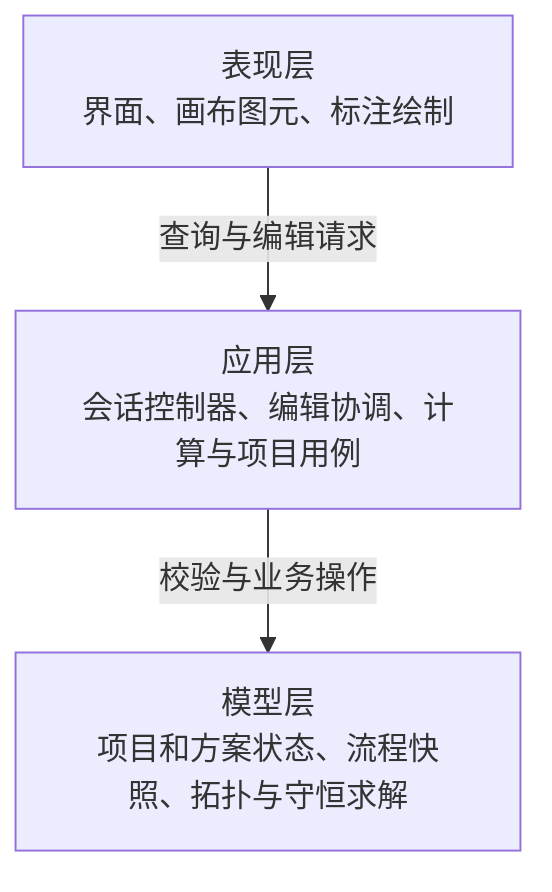
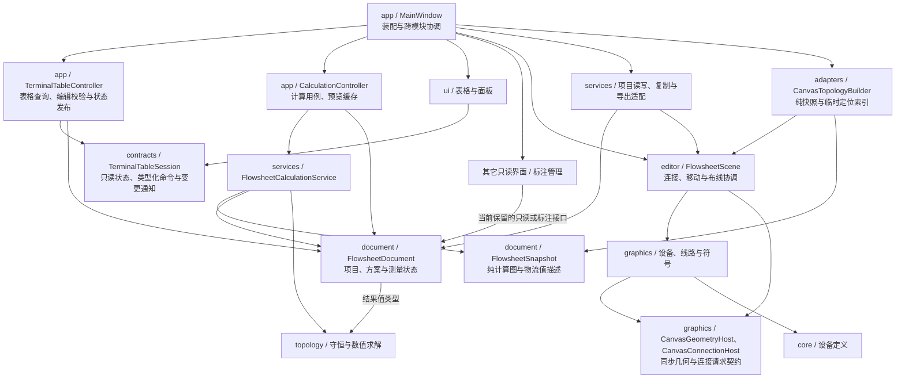

# AutoFlotationSheet

完整操作说明见 [用户操作手册](docs/USER_GUIDE.md)，代码分层与扩展约束见 [模块职责与依赖边界](docs/MODULE_BOUNDARIES.md)。

使用纯 C++20、Qt 6 Widgets 和 xmake 开发的浮选工艺流程图编辑器。

## 当前功能

- 论文式浮选单元、入料线和左右产品线；
- 左侧完整画布，右侧通过“显示设置”菜单或其右侧的面板下拉框切换表格、对象属性、计算问题和模板库，下拉框支持悬停滚轮切换，默认表格；操作日志固定在右侧底部，占右侧高度的八分之一；
- 输入表显示网格线并占满表格面板剩余区域；输入表初始列宽按可用宽度铺满，手动调整后保留列宽；对象属性数值立即生效，可设置本机增减步长；
- 本机流程模板库支持保存、搜索、重命名、删除和跨项目插入，提供可缩放、平移的只读预览；
- 三产品浮选单元支持左、中、右三条独立产品物流，并参与质量及多组分守恒计算；
- 可添加一进二出的二分流器，指定左支路比例后自动计算右支路比例，并在质量与各组分守恒中按相同比例分流；
- 浮选单元宽度和连接长度调整；
- 终端产品箭头可通过 `Ctrl++` / `Ctrl+-` 独立调节长度，支持较大范围并随项目保存；
- 产品到入料连接、整体移动和 `Ctrl+B` 断开；
- `Ctrl+Z` 撤销以及 `Ctrl+Y` / `Ctrl+Shift+Z` 重做项目编辑；
- “项目管理”菜单支持保存、项目另存为、导入和最近项目快速切换，另存成功后自动切换当前项目路径；
- 支持 `Ctrl+N` 新建空白项目，以及删除一个或多个选中单元并用 `Ctrl+Z` 恢复；
- 任意数量的普通产品或产品合并输出汇入同一条入料线，并以多输入汇合点形成开路合流或闭路回流；
- 两条或多条产品线合流、接入下一道浮选单元及拆分；支持从合流出料端拖向其它可用产品线继续合并；
- 右侧数据表显示最顶层总入料（合计）以及全部最终和中间产品；任意物流均可录入绝对干质量以及各组分品位，支持物流类别和选中流程的一跳关联筛选；是否足够由方程秩动态判断，例如二产品流程可用“入料 + 任一产品”或“两产品”反算其余物流；
- 产品名称默认留空，可在右侧表格填写并显示在画布产品箭头下方；仅已命名产品参与 Excel 导出；
- 右键产品线、合流线或入料线可添加药剂标注，归属以本次右键位置为准；支持双击编辑、`Delete` 删除，以及选中后用 `↑`/`↓` 调整垂直位置；
- 药剂标注支持显式的 `^` 上标、`_` 下标及花括号分组语法，普通数字保持原样以兼容药剂代号；
- 药剂标注可记录名称、用量、单位和备注；支持右键复制粘贴，也可单选药剂按 `Ctrl+C`，再单选目标物流线按 `Ctrl+V`；合流及回流按所选线段识别目标，连续粘贴可逐次撤销重做，新标注保存到当前方案；
- 合流产品及各支路参与完整流程的联立守恒计算，是否需要补充实测约束由方程秩决定；
- 使用广义线性方程组进行开路及多回流闭路的质量与多组分守恒反算，各组分独立计算品位和回收率，并识别唯一解、部分唯一解、欠定及矛盾数据；
- 终端合流产品可在中间支路欠定时先完成全流程平衡；
- 可拖动画布结果标注；
- 可通过“流程编辑 → 添加球磨机”插入圆形球磨机，支持一入一出连线及物料平衡；
- 可通过“流程编辑 → 添加浓密池”插入椭圆池口与锥底的浓密池，顶部入料、底部出料，采用一入一出物料平衡；
- 球磨机从圆底正中向下出料；所有设备图标下方均不绘制名称或说明小字；
- 选中结果指标框后可按 `Delete` 临时隐藏，重新计算时自动恢复；
- 可在画布上添加、拖动、双击编辑、删除和复制粘贴自定义文字图层；支持多条文字及文字与流程单元一起复制；
- 复制流程组时自动复制当前方案中相关物流的药剂标注，保留用量、备注、位置偏移和排列顺序，并绑定到副本物流；
- 可通过“标注样式”统一调整结果标注和产品名称的字号、粗体及文字颜色；
- 鼠标滚轮缩放及中键拖动画布视图；
- 底部状态栏持续显示当前选中的浮选单元类型、编号和多选数量；
- 右侧底部固定“操作日志”记录保存、导入、计算、导出和画布编辑结果，并展开计算错误与欠定提示；
- 复杂回流支路支持独立调整横向走廊和汇入高度；选中具体回流时自动高亮该支路并弱化其他回流；
- 干质量、各组分品位、全流程产率和各组分回收率显示设置；
- 画布中含计算质量或计算品位的结果卡使用加粗边框，产率和回收率不参与区分；可在“显示设置”中开关并自定义线宽，作为本机显示偏好记住；
- 指标框的质量单位可选择 `g`、`kg`、`t` 或自定义文本，并随项目保存；
- 指标标签可在中文名称与论文符号 `m / β / γ / ε` 之间切换；
- 明暗主题及 SVG、PNG、JPEG 流程图导出；支持将各方案中已命名产品的数据导出为 Excel 工作簿。
- 项目保存使用 v24 格式，读取兼容 v23 和 v24，可恢复拓扑、闭路、实测数据和标注位置；v23 共享文字会复制到每个方案，之后独立修改；其他版本直接拒绝。
- 同一拓扑支持多套试验方案，方案间独立保存自定义文字、药剂制度、实测数据和计算结果，并支持复制、切换、重命名、删除及结果对比。

Python/PySide6 验证原型保存在 `python-prototype/`，当前产品代码位于 `src/`。

## 项目架构

### 三层总览

主干按表现、应用、模型三层组织。总览展示请求处理方向；下方详细图展示具体模块与契约依赖，返回值和事件通知不表示反向依赖具体实现。



表格通过 `TerminalTableSession` 查询只读状态、提交类型化命令，`TerminalTableController` 负责校验和文档写入；`CalculationController` 统一计算预览与缓存。图元通过几何、连接两个窄接口请求场景执行操作，不引用具体编辑器场景。

### 模块依赖详情

<details>
<summary>展开主要实现模块与共享契约</summary>



详细图省略通用 Qt 和共享值类型依赖。`CanvasItemIndex` 仅在应用层临时定位，图元指针不进入表格模型或计算快照。`topology` 仅依赖 QtCore。

</details>

当前场景仍承载图元连接结构，其它部分只读界面仍读取文档；三层总览不表示已经完成独立流程模型改造。详细实现入口见 [架构说明](docs/ARCHITECTURE.md)，代码归属与依赖约束见 [模块职责与依赖边界](docs/MODULE_BOUNDARIES.md)。

## 环境

### Linux

- GCC 或 Clang（支持 C++20）；
- Qt 6 开发包（Core、Gui、Widgets、Svg）；
- xmake。

以 Ubuntu/Debian 为例，Qt 依赖可通过系统包安装：

```bash
sudo apt install qt6-base-dev qt6-svg-dev
```

如果 `qmake6` 在 `PATH` 中，xmake 会自动发现 Qt；否则在配置时通过 `--qt=/path/to/Qt` 指定 Qt SDK 根目录。

### Windows

- Qt：`C:/Qt/6.11.1/mingw_64`
- MinGW：`C:/Qt/Tools/mingw1310_64`
- xmake：`C:/Users/13427/xmake/xmake.exe`

## 配置、构建和部署

### Linux

使用系统 Qt：

```bash
xmake f -p linux -m release
xmake
xmake run AutoFlotationSheet
```

使用独立安装的 Qt：

```bash
xmake f -p linux -m release --qt=/opt/Qt/6.11.1/gcc_64
xmake
```

生成程序为 `build/bin/AutoFlotationSheet`。`xmake deploy` 会将程序整理到 `build/deploy/bin/`；Linux 默认使用系统提供的 Qt 动态库。如需制作可分发的 AppImage 或私有运行时包，可在此目录结构上继续打包。

### Windows

```powershell
C:\Users\13427\xmake\xmake.exe f --qt="C:/Qt/6.11.1/mingw_64" -p mingw
C:\Users\13427\xmake\xmake.exe
C:\Users\13427\xmake\xmake.exe deploy
```

生成程序：`build/bin/AutoFlotationSheet.exe`。

构建前请关闭正在运行的程序，否则 Windows 会锁定 EXE，链接器无法覆盖。`xmake deploy` 使用匹配版本的 `windeployqt` 强制刷新 Qt DLL，避免入口点冲突。

## 测试

当前有 17 个测试目标。`xmake build -a` 可一次构建主程序及全部测试；涉及主窗口交互的目标额外依赖 Qt Test。可使用统一入口完成构建、全部检查及 v23/v24 项目启动验证：

```bash
python3 scripts/validate.py
# 需要从干净构建开始时：
python3 scripts/validate.py --clean
```

需先配置好 Qt/xmake；xmake 不在 PATH 时使用 `--xmake /path/to/xmake`，日志与退出码汇总位于 `build/validation/latest/`。验证脚本仅使用 Python 3 标准库，产品仍为 C++/Qt 程序。各目标职责与单独运行命令如下。

Linux：

```bash
xmake build topology_test
xmake build calculation_service_test
xmake build table_session_test
xmake build connection_test
xmake build merge_test
xmake build terminal_input_test
xmake build stream_filter_interaction_test
xmake build clipboard_interaction_test
xmake build result_source_interaction_test
xmake build ball_mill_interaction_test
xmake build thickener_interaction_test
xmake build workspace_tools_interaction_test
xmake build canvas_view_test
xmake build export_test
xmake build excel_export_test
xmake build closed_loop_test
xmake build project_io_test
xmake run topology_test
xmake run calculation_service_test
xmake run table_session_test
QT_QPA_PLATFORM=offscreen xmake run connection_test
QT_QPA_PLATFORM=offscreen xmake run merge_test
QT_QPA_PLATFORM=offscreen xmake run terminal_input_test
QT_QPA_PLATFORM=offscreen xmake run stream_filter_interaction_test
QT_QPA_PLATFORM=offscreen xmake run clipboard_interaction_test
QT_QPA_PLATFORM=offscreen xmake run result_source_interaction_test
QT_QPA_PLATFORM=offscreen xmake run ball_mill_interaction_test
QT_QPA_PLATFORM=offscreen xmake run thickener_interaction_test
QT_QPA_PLATFORM=offscreen xmake run workspace_tools_interaction_test
QT_QPA_PLATFORM=offscreen xmake run canvas_view_test
QT_QPA_PLATFORM=offscreen xmake run export_test
xmake run excel_export_test
QT_QPA_PLATFORM=offscreen xmake run closed_loop_test
QT_QPA_PLATFORM=offscreen xmake run project_io_test
```

Windows：

```powershell
C:\Users\13427\xmake\xmake.exe build topology_test
C:\Users\13427\xmake\xmake.exe build calculation_service_test
C:\Users\13427\xmake\xmake.exe build table_session_test
C:\Users\13427\xmake\xmake.exe build connection_test
C:\Users\13427\xmake\xmake.exe build merge_test
C:\Users\13427\xmake\xmake.exe build terminal_input_test
C:\Users\13427\xmake\xmake.exe build stream_filter_interaction_test
C:\Users\13427\xmake\xmake.exe build clipboard_interaction_test
C:\Users\13427\xmake\xmake.exe build result_source_interaction_test
C:\Users\13427\xmake\xmake.exe build ball_mill_interaction_test
C:\Users\13427\xmake\xmake.exe build thickener_interaction_test
C:\Users\13427\xmake\xmake.exe build workspace_tools_interaction_test
C:\Users\13427\xmake\xmake.exe build canvas_view_test
C:\Users\13427\xmake\xmake.exe build export_test
C:\Users\13427\xmake\xmake.exe build excel_export_test
C:\Users\13427\xmake\xmake.exe build closed_loop_test
C:\Users\13427\xmake\xmake.exe build project_io_test
```

GUI 测试在无界面环境运行时设置：

```powershell
$env:PATH="C:\Qt\6.11.1\mingw_64\bin;C:\Qt\Tools\mingw1310_64\bin;$env:PATH"
$env:QT_QPA_PLATFORM="offscreen"
```

测试职责：

- `topology_test`：纯拓扑校验、排序和三级开路反算；
- `connection_test`：产品连接、组件移动、长度调整、缩短产品线后的下游折线、线段/箭头命中及断开；
- `merge_test`：产品合流几何、下游正交连接、人工汇合高度及拆分；真实鼠标拖拽覆盖合流出料继续合并、反向拖入、名称/ID/手动高度保留、空白及无效投放和已有连接保护，额外链接 Qt Test；
- `terminal_input_test`：终端输入、主题、计算服务、详情表和标注交互。
- `stream_filter_interaction_test`：通过真实主窗口的鼠标和键盘交互，覆盖单选/多选、一跳物流筛选、表格双向定位与编辑、回流和产品汇流、方案/项目切换、删除和撤销后的筛选刷新，以及产品命名和 Excel 排序/导出提示；该目标额外链接 Qt Test。
- `clipboard_interaction_test`：文字按方案独立编辑/移动/删除与跨方案粘贴、文字单独/多选/混合复制、流程组药剂归属和堆叠、单条药剂的右键及快捷键复制粘贴、最近复制类型切换与目标选择、合流/回流支路目标、方案切换、快捷键与菜单、样式和位置、重复粘贴、撤销重做、保存读取及普通输入框的剪贴板行为；该目标额外链接 Qt Test。
- `result_source_interaction_test`：结果卡边框、多组分混合来源、指标显隐、绘制及 SVG 导出、本机显示偏好、样式编辑、项目切换及撤销重做不影响偏好、方案切换和数据协调；该目标额外链接 Qt Test。
- `ball_mill_interaction_test`：设备图标无下方小字、菜单添加、圆形选择、球磨机顶部入料/底部出料、直连/汇流/回流、一入一出质量和品位守恒、项目读写、复制粘贴、撤销重做及 SVG 圆形导出；该目标额外链接 Qt Test。
- `thickener_interaction_test`：浓密池一入一出、菜单与尺寸交互、上下端口、物料守恒、连接/汇流/回流、复制、项目读写、撤销重做和 SVG 图形。
- `workspace_tools_interaction_test`：右侧上方页面独占切换、顶部下拉框与菜单及程序跳转同步、悬停滚轮方向/边界/小步滚动、固定日志及八分之一高度、默认表格、页面状态保留、属性面板、计算问题定位和组分输入跳转、欠定/矛盾/协调警告的面板跳转策略、流程模板的本机持久化、跨窗口插入、重命名/删除、布线与标注保留及撤销重做；模板预览的只读隔离、缩放平移、主题和错误状态。
- `canvas_view_test`：滚轮缩放边界、中键平移、`Space` 配合方向键平移、`Home` 适应窗口，以及药剂标注方向键优先级。
- `export_test`：SVG、PNG 和 JPEG 文件生成及格式校验。
- `excel_export_test`：多方案 XLSX 数据、仅命名产品导出、命名/清空名称后的筛选、排序与合并单元格、空导出保护及文件结构校验。
- `closed_loop_test`：回流汇合、闭路拓扑识别、断开及计算保护。
- `table_session_test`：无需 Qt Widgets 的表格会话命令校验、只读状态、方案切换与失效目标保护；表格 UI 的契约替身检查归入 `terminal_input_test`，几何/连接接口替身检查归入 `connection_test`。
- `calculation_service_test`：只链接 QtCore/QtGui、文档和求解服务，验证无需画布的部分可解、严格平衡、多组分矛盾、数据协调及支路约束输入。
- `project_io_test`：项目数据与方案/标注往返、v23 迁移与格式拒绝检查、开闭路连接、设备类型、撤销/复制及样例读取；入口位于 `ProjectIoTest.cpp`，具体检查按职责放在 `ProjectIo*Checks.cpp`。

## 常用操作

左侧为完整画布，右侧通过顶部“显示设置”菜单或旁边的面板下拉框，在“表格、对象属性、计算问题、模板库”之间切换，每次由选中页面独占右侧上方区域，启动默认显示表格。底部固定显示操作日志，高度为右侧的八分之一，随窗口大小保持比例。鼠标悬停在面板下拉框上即可滚轮切换：向下下一项、向上上一项，到首尾停止；下拉框、菜单勾选及实际页面保持同步。切换保留各页面状态，可拖动中间分隔线调整宽度。

- 右侧“对象属性”：实时编辑设备尺寸、入料/出料线长及路线坐标，可设置增减步长，也可填写产品名称；
- 右侧“计算问题”：仅在计算出现守恒方程矛盾时自动跳转，欠定或协调残差警告保留当前面板；单击定位画布对象，双击切换到表格编辑对应输入；
- “流程模板库”：将选中流程保存到本机，单击可预览设备、布线、文字和药剂，支持缩放、平移及适应窗口；点击插入或双击列表项，在不同项目中复用带新 ID 的副本；

- 顶部工具栏按“项目管理”“流程编辑”“方案设置”“显示设置”“导出选项”分组为下拉菜单；当前试验方案仍可直接通过下拉框切换；
- “试验方案”下拉框：切换当前自定义文字、药剂制度和实验数据组；
- 右侧“计算模式”：按方案切换严格平衡或带测量标准差的数据协调；
- “新增方案”：创建空白数据组；“复制方案”：基于当前方案创建副本；
- “组分设置”：每行输入一个组分名称；右侧表格会为每种组分生成品位列；
- “方案对比”：选择任一最终或中间产品，横向比较各已计算方案的质量、产率以及每种组分的品位和回收率；
- `Ctrl+C` / `Ctrl+V`：复制粘贴画布中的设备、自由文字或单条药剂；复制药剂后须单选目标物流线再粘贴，复制设备或文字后则粘贴对应副本。右键药剂菜单与快捷键共用药剂快照，输入框保留普通文本剪贴板行为；
- `Ctrl + +` / `Ctrl + -`：调整选中浮选单元宽度或连接长度；
- `Ctrl + B`：断开连接或拆分合流；
- 将产品箭头拖到同一流程中的上游入料线：建立回流闭路；
- 将产品合并线末端箭头拖到新浮选单元的入料线：将合流产品送入下一道流程；
- `Ctrl + Shift + T`：切换 CAD 暗色画布与明亮主题；
- `Ctrl + S`：保存当前项目；`Ctrl + O`：导入已有项目；
- 鼠标滚轮：以指针位置为中心缩放画布；
- 按住鼠标中键拖动：平移画布视图；
- 按住 `Space` 拖动或配合方向键：平移视图；`Shift` 加方向键可加大平移步长；`Home` 适应全部画布内容；
- 选中药剂标注后按 `↑` / `↓`：上下微调 2 个画布单位；按住 `Shift` 时每次调整 10 个画布单位；
- “显示指标”：整体显示或隐藏结果标注；
- “指标设置”：选择标注显示的计算指标；
- “导出”：选择 SVG、PNG 或 JPEG 格式保存完整流程图及当前可见标注。
- “导出Excel”：按方案分组，仅导出用户指定名称且具有计算结果的物流，包括已命名的总入料、最终产品和中间产品；名称默认留空，未命名物流不导出，也不使用默认名称回退。
- “设置 Excel 行顺序”：仅列出已命名物流，可拖动调整在工作簿中的顺序；可恢复为流程顺序，尚未配置顺序的已命名物流按流程顺序追加。

## 闭路操作

将尚未连接的普通产品箭头或产品合并后的输出箭头拖到目标入料线上，入料线高亮后松开，即可创建入料汇合；可以继续向同一位置拖入更多物流，来源数量不设固定上限。同一连通流程内的上游连接会作为回流闭路处理。目标入料既可以是未连接的新鲜入料，也可以已经连接上一段产品或合流产品；已连接的入料线虽然平时隐藏，原位置仍保留投放热区，拖入时会临时显示并高亮。程序会保留原正常上游物流并增加汇合点。拖动产品合并输出时，应从合并线末端的箭头处开始。各输入线沿浮选单元外侧错开布置。在多输入汇流中单击具体来源支路使其高亮，再按 `Ctrl+B` 只断开该来源；选中公共汇流线或汇流点且未选中具体来源时，`Ctrl+B` 才整体断开并恢复原正常上游连接。

闭路建立后，“物流实测参数”面板会自动增加所有回流环所需的数据行：普通产品回流填写该回流物流的干质量和品位；产品合并输出回流填写合并前各回流支路的数据，合并后的总回流由守恒关系自动计算。一个项目可包含多个彼此独立的主流程，每个流程均可有自己的外部新鲜入料；填写全部终端产品和回流支路后即可联动反算内部物流及各外部入料。多个外部入料并存时，流程图中的产率与回收率以全部外部入料合计为基准。

如果缺少回流实测值，闭路方程通常不唯一，计算结果会报告数据不足。全流程产率和回收率始终以反算得到的外部新鲜入料合计为基准。

## 导出说明

- Excel 数据导出生成标准 `.xlsx` 工作簿，第一列按方案合并；未命名物流、未计算方案和没有计算结果的产品物料行会自动忽略；没有可导出数据时提示补充名称或计算，不生成空工作簿；
- Excel 行顺序是项目共享设置，所有方案使用相同顺序；被删除或未命名物流自动忽略，尚未配置顺序的已命名物流按流程顺序追加；
- “产品名称”默认留空；“物流/入料定义”只负责定位，不作为产品名称或 Excel 名称回退。右侧显示筛选不限制 Excel 导出范围；

- SVG 为矢量格式，适合论文排版和后续编辑；
- PNG 为无损栅格格式，适合文档和演示文稿；
- JPEG 以 95% 品质输出，适合需要较小文件体积的场景；
- PNG/JPEG 可选择 1×、2×、3× 或 4× 输出倍率，默认 2×；文字较多时建议使用 3× 或 4×；
- 三种格式均按所有画布图元的实际范围导出，并在四周保留 30 个画布单位的空白；
- 导出统一使用白色背景。暗色主题下导出时，程序会临时按明亮主题绘制，完成后恢复界面主题；
- PNG/JPEG 会限制最长边和总像素数，超大画布会等比例缩小以控制内存占用。

代码结构见 [架构说明](docs/ARCHITECTURE.md)，代码归属准则见 [模块职责与依赖边界](docs/MODULE_BOUNDARIES.md)，职责调整及验收记录见 [架构检查记录](docs/ARCHITECTURE_REVIEW.md)，开发流程见 [开发指南](docs/DEVELOPMENT.md)，标注扩展见 [标注系统](docs/ANNOTATIONS.md)。
